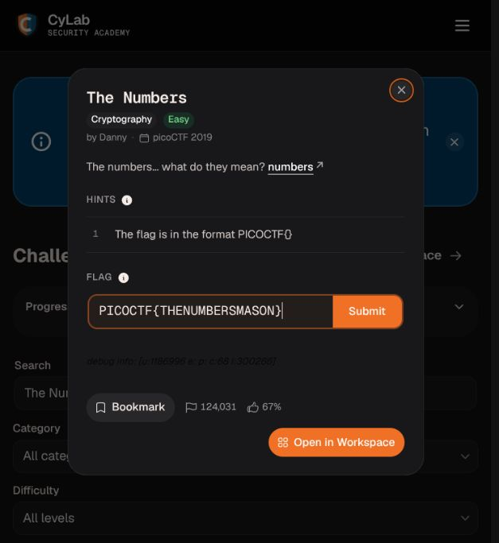
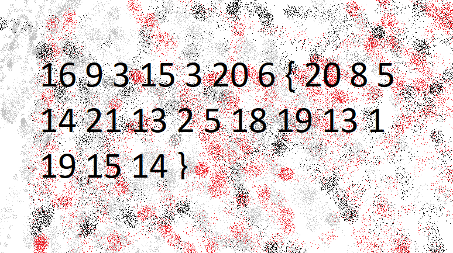
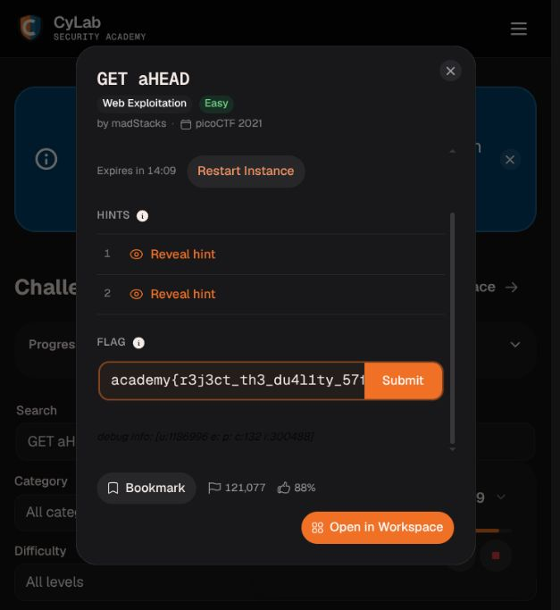
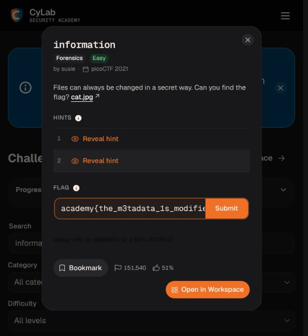
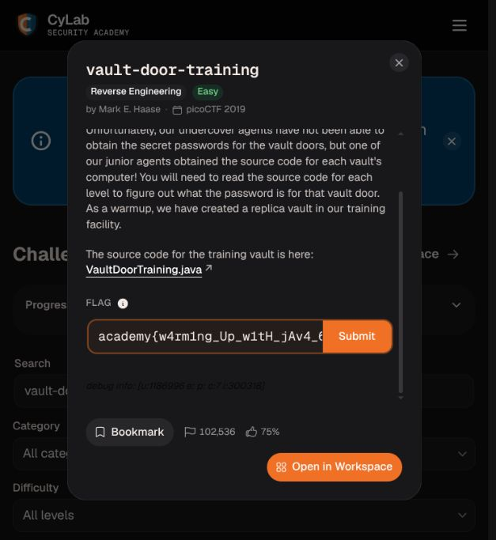
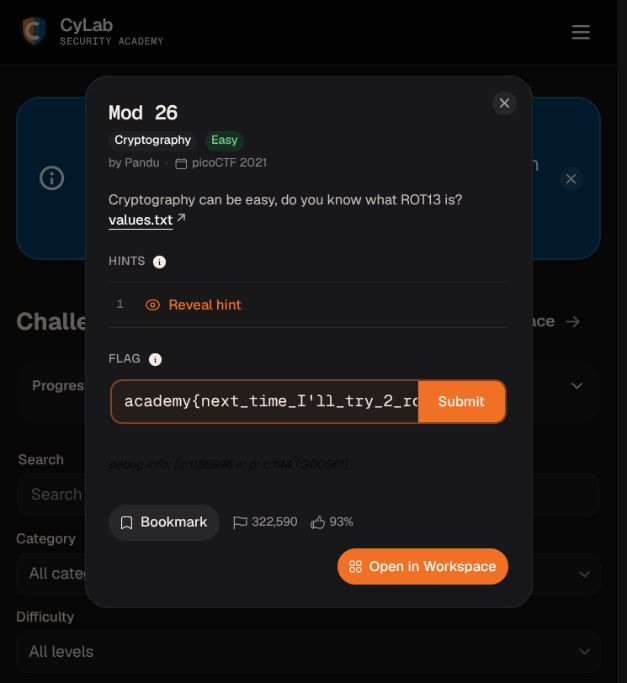
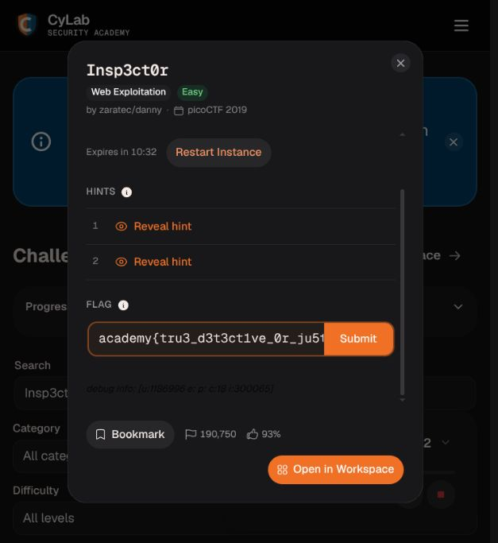
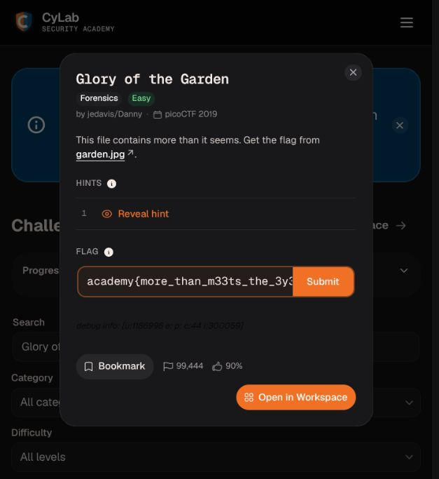
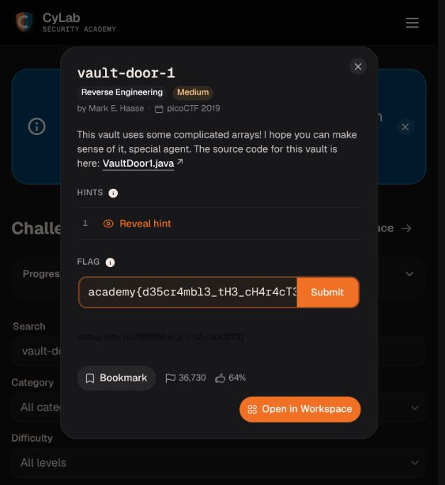

# A. Entrenamiento en CTFs

**Estudiante:** Juan Ignacio Bruzzone
**Fecha:** 14 de octubre de 2026

Esta entrega reúne ocho desafíos de práctica: dos de criptografía, dos de web, dos de análisis forense y dos de ingeniería inversa. En cada uno se explica cómo llegar a la flag y qué idea deja el ejercicio. Las flags se comprobaron en la versión actual de la plataforma.

**Plataforma:** CyLab Security Academy (antes picoCTF).

Las direcciones de las instancias web documentan esta ejecución y pueden dejar de funcionar al finalizarla.

| Desafío | Área | Dificultad |
|---|---|---|
| The Numbers | Criptografía | Fácil |
| GET aHEAD | Web | Fácil |
| information | Análisis forense | Fácil |
| vault-door-training | Ingeniería inversa | Fácil |
| Mod 26 | Criptografía | Fácil |
| Insp3ct0r | Web | Fácil |
| Glory of the Garden | Análisis forense | Fácil |
| vault-door-1 | Ingeniería inversa | Media |

---

## 1. The Numbers

**Plataforma y enlace:** [CyLab Security Academy - The Numbers](https://learn.cylabacademy.org/library/68)

**Categoría:** Criptografía | **Dificultad:** Fácil

### Resolución

1. La imagen muestra números separados por espacios y una parte entre llaves. Todos están entre 1 y 26, así que tiene sentido probar la posición de cada letra en el alfabeto: 1=A, 2=B y así hasta 26=Z.
2. Los primeros números, 16 9 3 15 3 20 6, dan PICOCTF. Eso confirma el patrón. Aplicando la misma conversión al resto aparece THENUMBERSMASON.
3. Se transcribió la secuencia a numeros.txt y se convirtió con Python. Las llaves se mantienen tal como aparecen en la imagen. La pista pide PICOCTF{} en mayúsculas, y ese fue el formato aceptado.

```text
16 9 3 15 3 20 6 {20 8 5 14 21 13 2 5 18 19 13 1 19 15 14}

python3 herramientas/resolver.py numeros archivos/numeros.txt

Resultado: PICOCTF{THENUMBERSMASON}
```

### Herramientas

Visor de imágenes y Python 3.

### Flag obtenida

```text
PICOCTF{THENUMBERSMASON}
```

**Validación:** la plataforma respondió `Correct flag!`.

### Aprendizaje

Antes de probar algo complicado conviene mirar el rango de los valores. Acá no hace falta una clave: es una sustitución directa de números por letras. El prefijo de la flag sirve para comprobar si la interpretación tiene sentido.

### Captura



Enunciado, pista del formato y flag reconstruida.



---

## 2. GET aHEAD

**Plataforma y enlace:** [CyLab Security Academy - GET aHEAD](https://learn.cylabacademy.org/library/132)

**Categoría:** Web | **Dificultad:** Fácil

### Resolución

1. La instancia devuelve una página con dos opciones: Choose Red y Choose Blue. En el HTML, un formulario usa GET y el otro POST. Esa diferencia, junto con el nombre del desafío, orienta a revisar los métodos HTTP.
2. La respuesta GET se guardó para leer el HTML. Después se hizo una petición HEAD a la misma dirección con curl. La opción -I pide las cabeceras sin descargar el cuerpo de la respuesta.
3. La respuesta HEAD trae una cabecera llamada flag. Su valor es la solución y la plataforma lo aceptó. La dirección y el puerto corresponden a esta ejecución; al iniciar otra instancia pueden cambiar.

```text
curl http://chatelaine.cylabacademy.net:16534/
curl -I http://chatelaine.cylabacademy.net:16534/

HTTP/1.1 200 OK
Server: Apache/2.4.38 (Debian)
X-Powered-By: PHP/7.2.34
flag: academy{r3j3ct_th3_du4l1ty_57f62d9}
Content-Type: text/html; charset=UTF-8
```

### Herramientas

curl y lectura del HTML descargado.

### Flag obtenida

```text
academy{r3j3ct_th3_du4l1ty_57f62d9}
```

**Validación:** la plataforma respondió `Correct flag!`.

### Aprendizaje

Mirar solamente lo que se ve en una página puede dejar afuera información útil. Las cabeceras también forman parte de la respuesta. En este desafío el servidor cambia su comportamiento según el método HTTP.

### Captura



Desafío web y flag obtenida de la cabecera HTTP.

---

## 3. information

**Plataforma y enlace:** [CyLab Security Academy - information](https://learn.cylabacademy.org/library/186)

**Categoría:** Análisis forense | **Dificultad:** Fácil

### Resolución

1. El archivo cat.jpg se identifica con file como una imagen JPEG de 2560 por 1598 píxeles. Eso indica el tipo de archivo, pero no alcanza para saber qué información extra contiene.
2. Con strings se buscaron cadenas legibles dentro del archivo. Al filtrar por license apareció un campo de metadatos XMP: cc:license, con un valor en rdf:resource. La cadena no parece una licencia normal y encaja con Base64.
3. Se decodificó ese valor con base64 -d y apareció la flag. En esta resolución se usaron file y strings; no fue necesario usar ExifTool. La flag se validó en la plataforma.

```text
file archivos/cat.jpg
strings archivos/cat.jpg | rg 'license'

<cc:license rdf:resource=
'YWNhZGVteXt0aGVfbTN0YWRhdGFfMXNfbW9kaWZpZWR9'/>

printf '%s' 'YWNhZGVteXt0aGVfbTN0YWRhdGFfMXNfbW9kaWZpZWR9' | base64 -d
academy{the_m3tadata_1s_modified}
```

### Herramientas

file, strings, ripgrep (rg) y base64.

### Flag obtenida

```text
academy{the_m3tadata_1s_modified}
```

**Validación:** la plataforma respondió `Correct flag!`.

### Aprendizaje

Una imagen puede guardar datos que no se ven al abrirla. En este caso están en los metadatos XMP. Base64 solo cambia la representación del texto: no lo cifra ni lo protege.

### Captura



Archivo del desafío y flag recuperada de sus metadatos.

---

## 4. vault-door-training

**Plataforma y enlace:** [CyLab Security Academy - vault-door-training](https://learn.cylabacademy.org/library/7)

**Categoría:** Ingeniería inversa | **Dificultad:** Fácil

### Resolución

1. El desafío entrega VaultDoorTraining.java. El método checkPassword compara la contraseña con una cadena fija mediante equals. Esa cadena contiene la parte interna de la flag.
2. También hay que mirar main: substring quita el prefijo academy{ y el último carácter antes de pasar la entrada a checkPassword. Por eso la cadena de equals, sola, no es la flag completa.
3. Se agregó el prefijo y la llave final. El programa se compiló con javac y se probó con la flag completa: respondió Access granted. Después la misma flag fue aceptada por la plataforma.

```text
String input = userInput.substring(
    "academy{".length(), userInput.length()-1);

return password.equals("w4rm1ng_Up_w1tH_jAv4_69bd4dc7adf");

javac -d tmp archivos/VaultDoorTraining.java
printf '%s\n' 'academy{w4rm1ng_Up_w1tH_jAv4_69bd4dc7adf}' | java -cp tmp VaultDoorTraining

Enter vault password: Access granted.
```

### Herramientas

Lectura del código Java, javac y java.

### Flag obtenida

```text
academy{w4rm1ng_Up_w1tH_jAv4_69bd4dc7adf}
```

**Validación:** la plataforma respondió `Correct flag!`.

### Aprendizaje

No alcanza con encontrar una cadena que parezca una contraseña. Hay que seguir cómo se procesa la entrada y qué se compara. Un secreto escrito directamente en el código queda expuesto a quien pueda leerlo.

### Captura



Código fuente disponible en la plataforma y flag reconstruida.

---

## 5. Mod 26

**Plataforma y enlace:** [CyLab Security Academy - Mod 26](https://learn.cylabacademy.org/library/144)

**Categoría:** Criptografía | **Dificultad:** Fácil

### Resolución

1. El enunciado menciona ROT13 y entrega values.txt. El texto empieza con npnqrzl{, que al desplazar cada letra 13 posiciones se convierte en academy{.
2. Se leyó el archivo y se aplicó ROT13 con Python, usando codecs.decode. El procedimiento mueve las letras y mantiene números, llaves, guiones bajos y el apóstrofo.
3. El resultado conserva exactamente las mayúsculas y minúsculas de la flag. Se copió completo, incluido el apóstrofo de I'll, y la plataforma lo aceptó.

```text
# Texto de values.txt
npnqrzl{arkg_gvzr_V'yy_gel_2_ebhaqf_bs_ebg13_5p5s5o36}

python3 herramientas/resolver.py rot13 archivos/values.txt

academy{next_time_I'll_try_2_rounds_of_rot13_5c5f5b36}
```

### Herramientas

Python 3 y el módulo estándar codecs.

### Flag obtenida

```text
academy{next_time_I'll_try_2_rounds_of_rot13_5c5f5b36}
```

**Validación:** la plataforma respondió `Correct flag!`.

### Aprendizaje

ROT13 es un desplazamiento fijo de 13 letras. Si se aplica dos veces se vuelve al texto original, porque 13 + 13 completa las 26 posiciones del alfabeto. No sirve para proteger un secreto.

### Captura



Texto del desafío y flag descifrada con ROT13.

---

## 6. Insp3ct0r

**Plataforma y enlace:** [CyLab Security Academy - Insp3ct0r](https://learn.cylabacademy.org/library/18)

**Categoría:** Web | **Dificultad:** Fácil

### Resolución

1. La página se llama Inspect Me. El HTML menciona los archivos mycss.css y myjs.js, además de mostrar que el sitio está hecho con HTML, CSS y JavaScript. Esos recursos también se descargan en el navegador, así que se pueden leer.
2. En un comentario del HTML aparece la parte 1/3 de la flag. Se siguieron los enlaces a la hoja de estilos y al JavaScript. En sus comentarios están las partes 2/3 y 3/3.
3. Se unieron los tres fragmentos en el orden indicado, sin agregar espacios. La tercera parte contiene la llave final. La flag completa fue aceptada por la plataforma. La dirección de la instancia puede cambiar al iniciar otra ejecución.

```text
curl http://xebec.cylabacademy.net:41074/
curl http://xebec.cylabacademy.net:41074/mycss.css
curl http://xebec.cylabacademy.net:41074/myjs.js

HTML (1/3): academy{tru3_d3
CSS  (2/3): t3ct1ve_0r_ju5t
JS   (3/3): _lucky?aa3ae7c8}

academy{tru3_d3t3ct1ve_0r_ju5t_lucky?aa3ae7c8}
```

### Herramientas

curl y lectura de los archivos HTML, CSS y JavaScript.

### Flag obtenida

```text
academy{tru3_d3t3ct1ve_0r_ju5t_lucky?aa3ae7c8}
```

**Validación:** la plataforma respondió `Correct flag!`.

### Aprendizaje

Un comentario no se ve en la página, pero sí está en el archivo que recibe el navegador. Separar información entre HTML, CSS y JavaScript no la vuelve privada. Para revisar una web también hay que mirar los recursos que carga.

### Captura



Instancia de Insp3ct0r y flag armada con los tres fragmentos.

---

## 7. Glory of the Garden

**Plataforma y enlace:** [CyLab Security Academy - Glory of the Garden](https://learn.cylabacademy.org/library/44)

**Categoría:** Análisis forense | **Dificultad:** Fácil

### Resolución

1. El archivo garden.jpg se identifica con file como un JPEG de 2999 por 2249 píxeles. El enunciado avisa que contiene más de lo que parece.
2. Se extrajeron las cadenas legibles con strings y se buscaron posibles prefijos de flag con rg. Apareció el texto Here is a flag seguido de la solución completa.
3. Como comprobación adicional, se comparó la ubicación de la flag con el marcador de fin de JPEG, FF D9. El marcador empieza en el byte 2295132 y la flag en el 2295150, contando desde cero: el texto está después del final de la imagen. La plataforma aceptó la flag.

```text
file archivos/garden.jpg
strings archivos/garden.jpg | rg 'academy\{|picoCTF\{|PICOCTF\{'

Here is a flag: academy{more_than_m33ts_the_3y3ee53c6bc}

Marcador de fin JPEG: byte 2295132
Inicio de la flag:    byte 2295150
```

### Herramientas

file, strings, ripgrep (rg) y Python 3 para verificar los offsets.

### Flag obtenida

```text
academy{more_than_m33ts_the_3y3ee53c6bc}
```

**Validación:** la plataforma respondió `Correct flag!`.

### Aprendizaje

Un visor puede mostrar una imagen normal aunque el archivo tenga texto agregado al final. Este caso es distinto de information: acá la flag está como texto después de la imagen, no dentro de un campo de metadatos.

### Captura



Imagen del desafío y flag encontrada entre las cadenas del archivo.

---

## 8. vault-door-1

**Plataforma y enlace:** [CyLab Security Academy - vault-door-1](https://learn.cylabacademy.org/library/12)

**Categoría:** Ingeniería inversa | **Dificultad:** Media

### Resolución

1. VaultDoor1.java verifica una contraseña de 32 caracteres. Las comparaciones charAt indican qué carácter debe haber en cada posición, pero las posiciones aparecen desordenadas.
2. La clave es ordenar por el índice de charAt, no por el orden de las líneas. Por ejemplo, charAt(0) pide d, charAt(1) pide 3 y charAt(2) pide 5. Se extrajeron los pares de índice y carácter con una expresión regular y se colocaron en una lista de 32 posiciones.
3. Al unir la lista se obtuvo d35cr4mbl3_tH3_cH4r4cT3r5_d66e42. main quita academy{ y la llave final, así que se agregaron para formar la flag. El programa compilado respondió Access granted. y la plataforma aceptó el resultado.

```text
python3 herramientas/resolver_vault1.py

d35cr4mbl3_tH3_cH4r4cT3r5_d66e42
academy{d35cr4mbl3_tH3_cH4r4cT3r5_d66e42}

javac -d tmp archivos/VaultDoor1.java
printf '%s\n' 'academy{d35cr4mbl3_tH3_cH4r4cT3r5_d66e42}' | java -cp tmp VaultDoor1

Enter vault password: Access granted.
```

### Herramientas

Python 3, expresiones regulares, javac y java.

### Flag obtenida

```text
academy{d35cr4mbl3_tH3_cH4r4cT3r5_d66e42}
```

**Validación:** la plataforma respondió `Correct flag!`.

### Aprendizaje

Desordenar las comprobaciones hace menos cómoda la lectura, pero no oculta los datos necesarios para reconstruir la contraseña. En este ejercicio importa entender los índices: charAt empieza a contar desde cero.

### Captura



Código fuente de vault-door-1 y flag reconstruida por posiciones.

---

## Referencias y apoyo

La plantilla inicial se tomó como estructura. Las resoluciones y la documentación se revisaron y reprodujeron con asistencia de Codex, usando los archivos actuales de la plataforma.

- Archivos originales y enunciados: los enlaces de cada desafío.
- [Manual de curl: opción -I / --head](https://curl.se/docs/manpage.html#-I).
- [Python: codecs y ROT13](https://docs.python.org/3/library/codecs.html#text-transforms).

Los scripts y archivos usados para reproducir las soluciones están incluidos en el paquete de respaldo.
